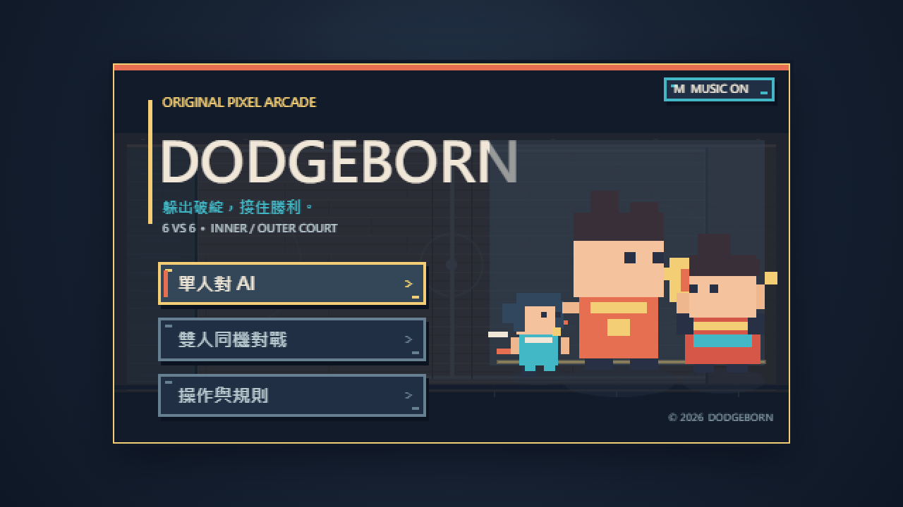
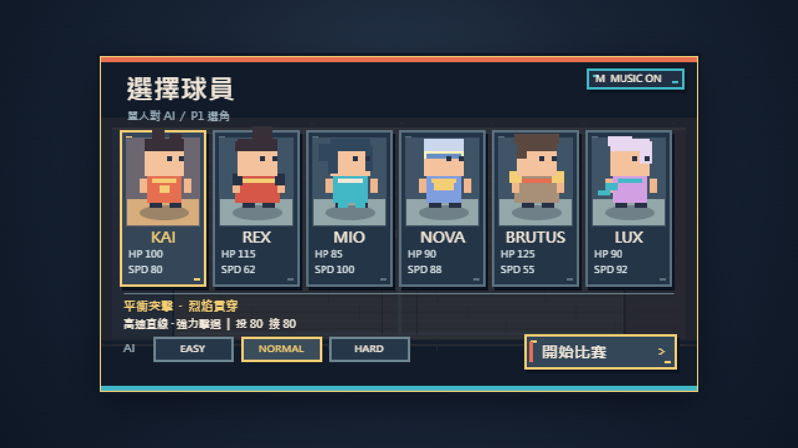
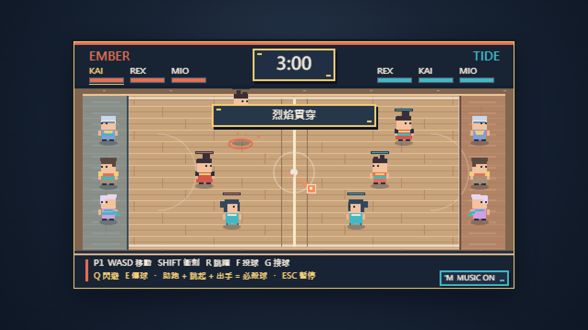

# DODGEBORN

[繁體中文](README.md) · [English](README.en.md) · [日本語](README.ja.md)

> 週末に作り始めた、少し本気の 2D ドッジボール。ダッシュ、ジャンプシュート、キャッチからの反撃、まっすぐ飛ぶ気のない必殺球。

**名前について：**競技の英語表記は **dodgeball**。でも作品名は **DODGEBORN**。打ち間違いに気づいた頃には、最初のボールがもう飛んでいました。せっかく生まれたボールなので、そのまま選手登録。英単語の新しい綴りを提案しているわけではありません。🏐

**オンラインデモ：**公開 GitHub リポジトリを作成した後、Vercel に読み込む予定です。まだデプロイしていないため、確認できた URL は公開後に追加します。[デプロイ手順](docs/DEPLOYMENT.md)をご覧ください。



| キャラクター選択 | 試合画面 |
| --- | --- |
|  |  |

## 週末のコートにあるもの

- **6 対 6：**各チームに内野 3 人、外野 3 人。内野全員が退場すると負けです。
- **オリジナルの 6 キャラクターと 6 種の必殺球：**助走して跳び、タイミングを合わせて投げます。それぞれに当たり判定と対処法があります。
- **キャッチ、回避、パス、反撃：**タイミングの良いキャッチは次の投球を強化します。
- **一人用とローカル対戦：**Easy・Normal・Hard の AI と、2 人分のキーボード操作に対応。
- **ピクセルアーケード：**480×270 の画面、プログラムで描くアートと演出、オリジナルの Web Audio 音楽と効果音。

## 遊び方

友達に渡す場合は、[オフライン ZIP の説明](docs/PACKAGING.md)に沿って作成してください。受け取った人は ZIP を展開し、Windows のデスクトップ版 Chrome または Edge で `DODGEBORN.html` を開きます。Node.js、アカウント、ネット接続は不要です。ネイティブのインストーラーではなく、ブラウザで動くポータブル版です。

開発する場合は Node.js 22.17 以降を用意し、リポジトリのルートで実行します。

```powershell
npm run dev:local
```

`http://127.0.0.1:4173` を開いてください。このオフライン手順では npm パッケージのインストールは不要です。正式なツールチェーンの検証状況は[受け入れ記録](docs/ACCEPTANCE.md)を参照してください。

| 操作 | プレイヤー 1 | プレイヤー 2 |
| --- | --- | --- |
| 移動 | WASD | 矢印キー |
| ダッシュ | 左 Shift | 右 Shift |
| ジャンプ | R | I |
| 投球 | F／Space | K／Enter |
| キャッチ | G | L |
| 回避 | Q | O |
| パス | E | U |

`Esc` または `P` で一時停止。`M` または画面の MUSIC ボタンで BGM を切り替えます。ブラウザでは最初のキー入力かクリック後に音楽が始まります。助走からジャンプして空中で投げると必殺球です。

## 技術構成

| 場所 | 役割 |
| --- | --- |
| [`apps/web`](apps/web) | Canvas 2D 描画、入力、UI、Web Audio |
| [`packages/core`](packages/core) | ブラウザから独立した固定 60 Hz のルール、ボールの所有、連続衝突判定、ダメージ、AI |
| [`packages/content`](packages/content) | キャラクター、必殺球、コート、バランス設定 |
| [`packages/shared`](packages/shared) | 共通の型とイベント |
| [`tests`](tests) | コア、統合、AI、ブラウザのテスト |

ブラウザは絵と音を担当し、コアは「今の球は本当に当たったか」を判定します。詳しくは[ゲーム設計](docs/GAME_DESIGN.md)へ。現在の描画は Canvas 2D で、Phaser への移行は未決定です。[設計判断](docs/DECISIONS.md)と[既知の課題](docs/KNOWN_ISSUES.md)も公開しています。

## 検証とオープンソース

```powershell
npm run test:local
npm run build:local
```

オフラインビルドと実際の Chrome での回帰テストは通過しています。正式な TypeScript、Vitest、Vite、複数ブラウザの検証には、まだ依存パッケージの導入が必要です。**遊べるプレビュー版は正式なリリース候補とは別です。** 詳細は[受け入れ記録](docs/ACCEPTANCE.md)。Vercel のデモサイトは、この GitHub リポジトリを Vercel の画面から読み込んだ後に静的な `dist/` を公開します。リポジトリの準備だけでは公開されません。

コードは [MIT ライセンス](LICENSE)。オリジナルのプログラム描画、スクリーンショット、音楽、効果音は[素材ライセンス一覧](docs/ASSET_LICENSES.md)に記載しています。[貢献ガイド](CONTRIBUTING.md)と[セキュリティ方針](SECURITY.md)もご覧ください。ボールは場外に飛んでも、認証情報は場外に出さないでください。
